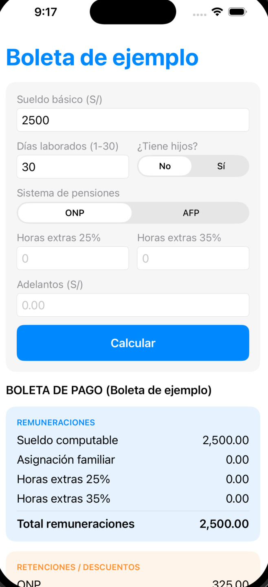
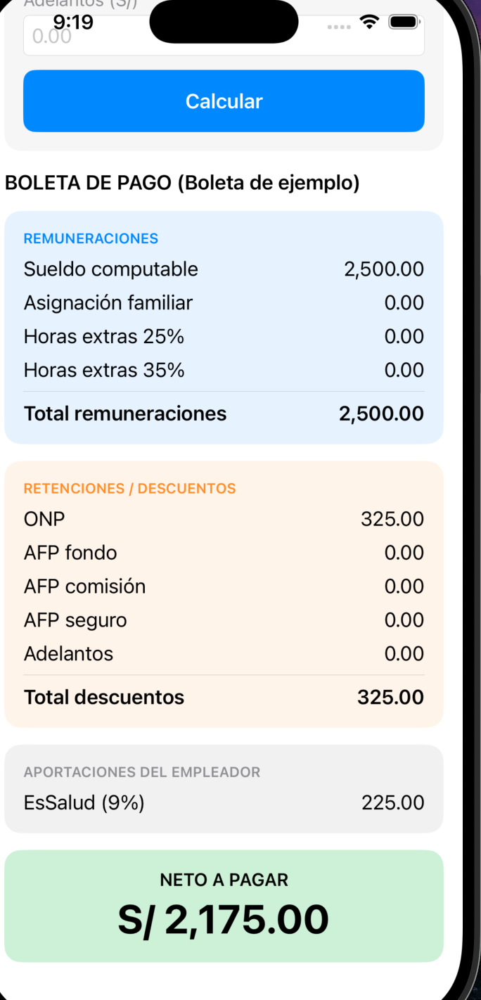
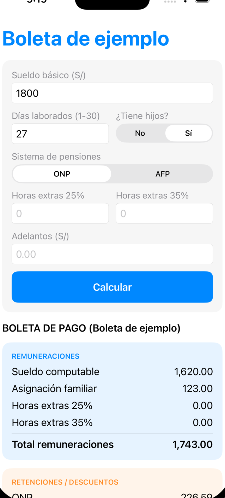
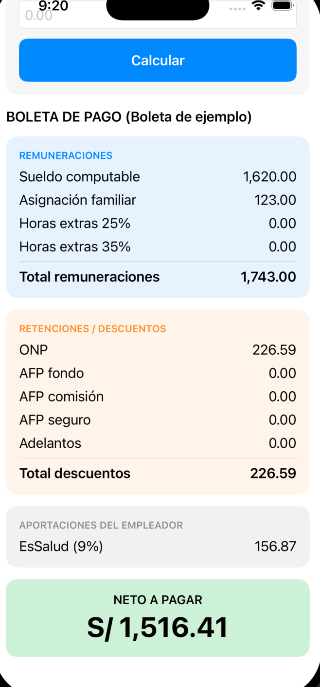
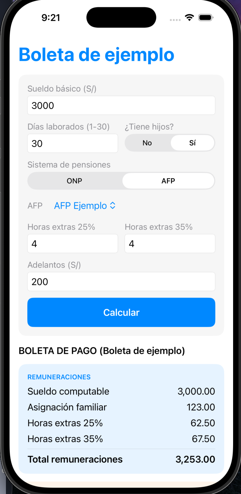
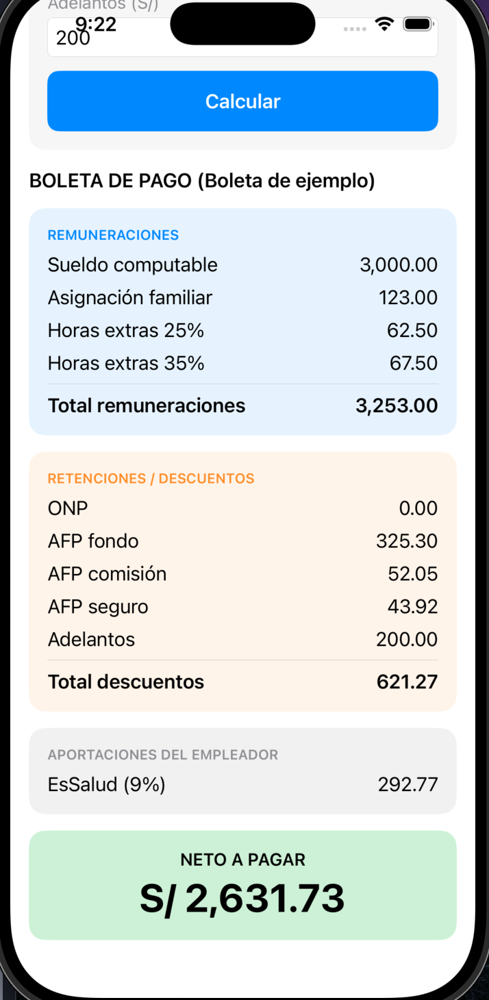
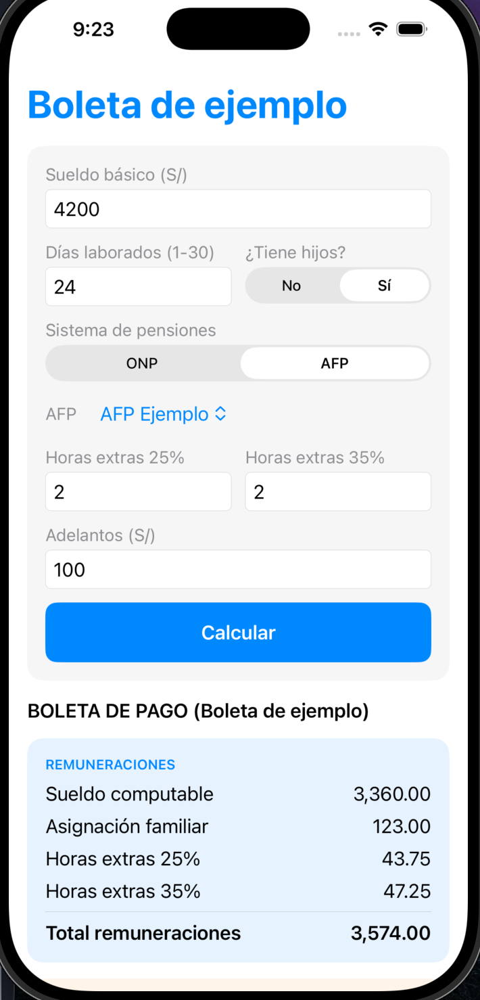
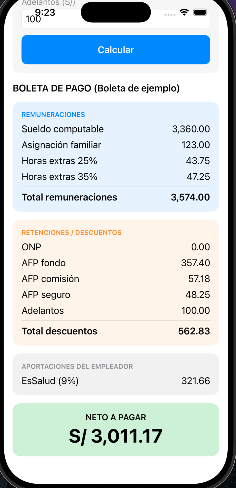

# Boleta de pago: del sueldo al neto

App de una sola pantalla en SwiftUI que calcula una boleta de pago simplificada.
Curso: Programación en Móviles Avanzado, Tecsup.

**Boleta de ejemplo.** Todos los datos son ficticios.

## Integrantes

- Sarai Soto Lopez: aplicación móvil (SwiftUI) y repositorio
- Jhon Kevin Jesus Vargas Choque: hoja de Excel con las fórmulas

## Estructura del proyecto

- `Boleta.swift`: modelo. Parámetros en un solo lugar, diccionario con las tasas de cada AFP, structs de datos, struct Concepto y la clase Boleta que calcula. Los conceptos de remuneraciones y descuentos van en arrays.
- `ContentView.swift`: pantalla única con formulario, validaciones, botón Calcular y la boleta con sus tres bloques (Remuneraciones, Retenciones / Descuentos y Aportaciones del empleador) y el neto.
- `CasosPrueba.swift`: calcula los 4 casos del enunciado y compara con las respuestas dadas. Se ejecuta al abrir la app y escribe el resultado en la consola.
- `Boleta_swiftApp.swift`: punto de entrada de la app.

## Cómo se calcula

- Se usa Decimal y cada concepto se redondea a 2 decimales antes de sumar.
- ONP y AFP se calculan sobre el total de remuneraciones.
- EsSalud lo paga el empleador y no se descuenta al trabajador.
- No se calcula Renta de 5.ª categoría.

## Casos de prueba

| Caso | Total remuneraciones | Total descuentos | Neto a pagar | EsSalud |
| --- | --- | --- | --- | --- |
| 1 | 2,500.00 | 325.00 | 2,175.00 | 225.00 |
| 2 | 1,743.00 | 226.59 | 1,516.41 | 156.87 |
| 3 | 3,253.00 | 621.27 | 2,631.73 | 292.77 |
| 4 | 3,574.00 | 562.83 | 3,011.17 | 321.66 |

Los casos 1, 2 y 3 coinciden con las respuestas del enunciado. El caso 4 no trae respuesta: lo revisa el docente.

### Caso 1: S/ 2,500, 30 días, sin hijos, ONP

### Caso 2: S/ 1,800, 27 días, con hijos, ONP

### Caso 3: S/ 3,000, 30 días, con hijos, AFP, 4 y 4 horas extras, adelanto S/ 200

### Caso 4: S/ 4,200, 24 días, con hijos, AFP, 2 y 2 horas extras, adelanto S/ 100

## Tabla de fuentes

| Dato | Valor | Fuente | Fecha de consulta |
| --- | --- | --- | --- |
| RMV | S/ 1,230.00 | D.S. de la RMV, vigente desde el 1 de octubre de 2026 | 28/10/2026 |
| Asignación familiar | 10% de la RMV = S/ 123.00 | Ley 25129 | 28/10/2026 |
| ONP | 13% | D.L. 19990 | 28/10/2026 |
| EsSalud | 9% | Ley 26790 | 28/10/2026 |
| Horas extras | 25% las primeras horas, 35% las siguientes | Normas de jornada y sobretiempo | 28/10/2026 |
| AFP Ejemplo | Fondo 10.00%, comisión 1.60%, seguro 1.35% | Valores de prueba del enunciado (en datos reales, usar los de la SBS) | 28/10/2026 |

## Cómo ejecutar

1. Abrir el proyecto en Xcode.
2. Elegir un simulador de iPhone.
3. Presionar Cmd + R.